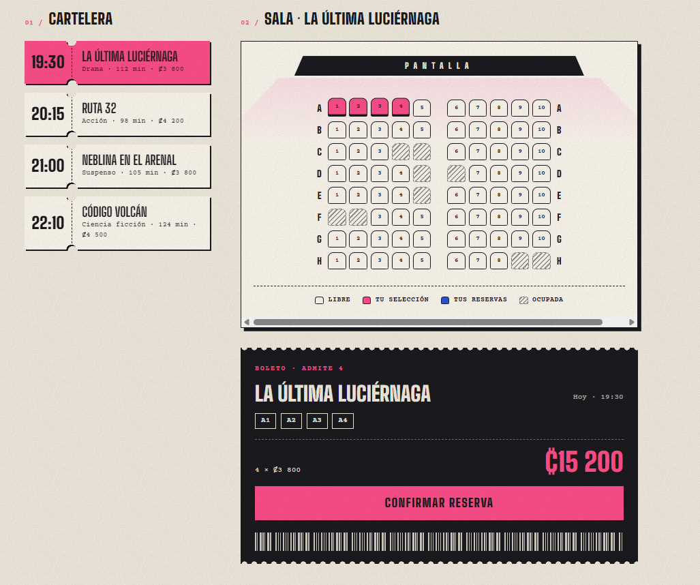

# CineSeat

Interactive movie theater seat picker built with **React** and **Vite**.

Choose a movie, pick your seats on the theater map and confirm the booking. Reservations are saved in the browser, so they are still there after a page reload.

**Live demo:** https://paulina-rc.github.io/cineseat/




## Tech stack

| Tool | Purpose |
|---|---|
| React | UI components and state |
| Vite | Dev server and production build |
| CSS | Component-scoped styles, no framework |
| GitHub Actions | Build and deploy on every push to `main` |

## Getting started

Requirements: [Node.js](https://nodejs.org/) LTS.

```bash
git clone https://github.com/paulina-rc/cineseat.git
cd cineseat
npm install
npm run dev
```

Open http://localhost:5173 in your browser.

## Scripts

| Command | What it does |
|---|---|
| `npm run dev` | Starts the development server |
| `npm run build` | Creates the production build in `dist/` |
| `npm run preview` | Serves the production build locally |
| `npm run lint` | Checks the code with oxlint |

## Project structure

```
src/
├── components/   # header, movieList, seatMap, seat, summary
├── data/         # movie catalog and theater layout
├── hooks/        # useLocalStorage
├── App.jsx       # main state and layout
├── main.jsx      # entry point
└── index.css     # global styles and design tokens
```

## Author

**Paulina Rojas** — [@paulina-rc](https://github.com/paulina-rc)

## License

MIT License. See [LICENSE](LICENSE) for details.
